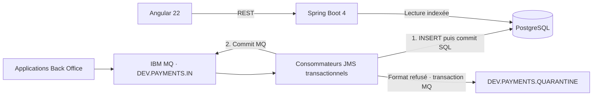

# Payment Message Hub

Application de consultation des messages de paiement reçus depuis IBM MQ. Le backend archive les messages dans PostgreSQL et expose une API REST ; l’interface Angular permet de rechercher les messages, d’en consulter les métadonnées et de télécharger leur contenu.

**Stack : Java 21, Spring Boot 4.1.1, Angular 22.2.3, PostgreSQL 17, Maven, IBM MQ Jakarta Client 9.4.5.1.** Aucune authentification ou autorisation applicative n’est implémentée, conformément au périmètre demandé.



La livraison MQ est **au moins une fois**. La contrainte unique `(source_queue, mq_message_id)` rend le stockage idempotent. Si le processus tombe après le commit SQL et avant le commit MQ, une relivraison ne crée pas de deuxième ligne. Il n’y a pas de transaction XA ni de promesse de livraison « exactly once ».

## Démarrage avec Docker

Prérequis : Docker Desktop démarré en mode conteneurs Linux, Docker Compose v2, environ 6 Go de mémoire disponibles et accès aux registres Docker/IBM. La première construction télécharge Java, Node, MQ et les dépendances ; elle peut prendre plusieurs minutes.

1. Cloner le dépôt et entrer dans son répertoire.

```sh
git clone https://github.com/elmansouriMed/testProjetELMANSOURI.git
cd testProjetELMANSOURI
```

2. Lire la [licence IBM MQ Advanced for Developers](https://www.ibm.com/docs/en/ibm-mq/9.4.x?topic=planning-mq-license-information), puis initialiser la configuration de développement. L’option ci-dessous matérialise votre acceptation de la licence pour l’image MQ de développement.

PowerShell 7 :

```powershell
./scripts/init-dev.ps1 -AcceptMqLicense
```

Linux / macOS avec OpenSSL :

```sh
sh scripts/init-dev.sh --accept-mq-license
```

Sans l’option d’acceptation, le script crée les fichiers et laisse `MQ_LICENSE` vide. Renseigner ensuite `MQ_LICENSE=accept` dans `.env`. Les scripts génèrent des mots de passe locaux, exclus de Git. Le secret `.secrets/mq-app-password.txt` et `MQ_PASSWORD` doivent rester identiques. Un changement ultérieur des mots de passe doit également être appliqué aux services existants.

Sous Linux, le répertoire `.secrets` reste privé (`0700`). Le fichier MQ est lisible par le processus du conteneur (`0444`), même si son identifiant utilisateur diffère de celui du poste ; le répertoire privé protège son accès par les autres utilisateurs locaux.

3. Démarrer la pile.

```sh
docker compose up -d --build --wait --wait-timeout 300
docker compose ps
```

| Service | Adresse |
|---|---|
| Interface Angular | http://localhost:4200 |
| API REST | http://localhost:8080/api/messages |
| Disponibilité de l’API et de PostgreSQL | http://localhost:8080/actuator/health/readiness |
| Métriques Prometheus | http://localhost:8080/actuator/prometheus |
| IBM MQ | localhost:1414 · QM1 · DEV.APP.SVRCONN |
| PostgreSQL | localhost:5432 · base/user `payments` |

Les ports sont liés à `127.0.0.1`. L’interface commence vide ; les données proviennent de MQ. La console d’administration MQ est désactivée dans cette configuration.

4. Publier des messages d’exemple **dans IBM MQ**, puis actualiser l’interface.

```sh
docker compose exec -T backend java -jar /app/app.jar --spring.main.web-application-type=none --app.mq.enabled=false --app.publisher.enabled=true --app.publisher.count=20
```

Pour tester la quarantaine, publier un `MapMessage`, format volontairement refusé :

```sh
docker compose exec -T backend java -jar /app/app.jar --spring.main.web-application-type=none --app.mq.enabled=false --app.publisher.enabled=true --app.publisher.count=1 --app.publisher.invalid=true
```

Le producteur crée des messages persistants, un identifiant de corrélation et une propriété `sourceApplication` (`BO-SEPA` ou `BO-SWIFT`). Il n’existe pas d’API d’injection de données en production.

## Tests

### Tests automatisés

Java 21+ et Maven 3.9.12 (ou le wrapper fourni) :

```sh
./mvnw verify
```

Sous Windows : `./mvnw.cmd verify`.

Les tests backend lancent un véritable PostgreSQL éphémère via Embedded Postgres, sans Docker et sans modifier la base de développement. Sous Linux, les lancer avec un utilisateur non root, PostgreSQL refusant de démarrer sous root. Le premier lancement télécharge les binaires PostgreSQL.

Node **24.15+ dans la branche 24**, ou une autre version officiellement compatible Angular 22 (`^22.22.3` ou `>=26`) :

```sh
cd frontend
npm ci
npm test
npm run build
```

Les tests couvrent les doublons concurrents, le rollback SQL, la pagination, les filtres, la validation HTTP, les contenus texte/binaire et la propagation des erreurs au listener MQ. Le test du listener utilise des doubles JMS ; le test suivant vérifie le courtier IBM réel.

### Test de bout en bout

Avec les quatre services démarrés, sous PowerShell 7 :

```powershell
./scripts/smoke-test.ps1
```

Le script publie des messages de test, attend leur archivage, vérifie un détail, les réponses 400/404, la quarantaine et la disponibilité de l’interface. Il ajoute des données de test aux volumes de développement et ne les efface pas.

### Reprise après panne

Test automatisé avec la pile de développement (il arrête puis relance PostgreSQL et ajoute 12 messages) : `./scripts/resilience-test.ps1`. Le script relance PostgreSQL même si une vérification échoue.

1. Arrêter PostgreSQL : `docker compose stop postgres`.
2. Publier dans MQ avec le producteur, en ajoutant `--spring.flyway.enabled=false --spring.datasource.hikari.minimum-idle=0 --spring.datasource.hikari.initialization-fail-timeout=-1` pour ne pas dépendre du démarrage SQL.
3. Vérifier que l’API renvoie 503 et que les messages restent dans MQ :

```sh
docker compose exec -T mq sh -c "echo 'DISPLAY QLOCAL(DEV.PAYMENTS.IN) CURDEPTH' | runmqsc QM1"
```

4. Relancer : `docker compose start postgres`. Attendre les reconnexions puis vérifier les messages archivés et la file vidée.
5. Tester aussi `docker compose restart mq` et `docker compose restart backend`.

La configuration MQ fournit `BOTHRESH(0)` afin qu’une panne SQL ne provoque pas un transfert automatique vers une file de backout avant archivage. Pour une file d’entreprise existante, faire vérifier ce paramètre par l’équipe MQ.

## API REST

Contrat complet : [docs/openapi.yaml](docs/openapi.yaml).

| Méthode et route | Usage |
|---|---|
| `GET /api/messages` | Liste de métadonnées sans contenu, du plus grand ID au plus petit |
| `GET /api/messages/{id}` | Métadonnées et contenu texte UTF-8 ou binaire Base64 |
| `GET /api/messages/statistics` | Indicateurs sur 24 h / 5 min, cache de 5 secondes |

Filtres facultatifs : `status=STORED|QUARANTINED`, `source`, `correlationId`, `mqMessageId`, `from`, `to`, `beforeId`, `limit` (1 à 100 ; 25 par défaut). Les filtres textuels sont **exacts et sensibles à la casse**. Les dates sont ISO 8601 avec fuseau, par exemple `2026-10-17T10:00:00Z`. La borne `from` est incluse, `to` est exclue.

```sh
curl "http://localhost:8080/api/messages?source=BO-SEPA&limit=10"
curl "http://localhost:8080/api/messages?status=QUARANTINED"
curl "http://localhost:8080/api/messages?beforeId=123&limit=25"
curl "http://localhost:8080/api/messages/1"
```

Utiliser `nextCursor` comme `beforeId` pour la page suivante. Les identifiants sont transmis en chaînes pour préserver les entiers 64 bits dans JavaScript. Aucun `COUNT(*)` global ni pagination par `OFFSET` ne sont nécessaires. La navigation est une vue vivante ; une actualisation recharge les arrivées récentes.

## Développement hors Docker applicatif

Démarrer seulement les dépendances : `docker compose up -d postgres mq`. Charger les variables de `.env` dans le terminal, puis :

```powershell
Get-Content .env | ForEach-Object { if ($_ -match '^([A-Z_]+)=(.*)$') { [Environment]::SetEnvironmentVariable($Matches[1], $Matches[2], 'Process') } }
./mvnw.cmd -pl backend spring-boot:run
```

Dans un second terminal :

```sh
cd frontend
npm ci
npm start
```

Le serveur Angular relaie `/api` vers `localhost:8080`. Aucun CORS permissif n’est nécessaire.

## Exploitation et volumétrie

- Quatre consommateurs par instance par défaut, ajustables par `MQ_CONSUMERS`. Pool SQL : `DB_POOL_SIZE=16` ; conserver de la capacité pour les lectures. Plusieurs instances peuvent consommer la même file. L’ordre métier global n’est pas garanti.
- Traitement synchrone borné : un message par transaction, pas de file applicative en mémoire. L’indisponibilité de SQL provoque le rollback MQ avec une pause d’une seconde par consommateur. Une rupture de connexion MQ déclenche une reprise exponentielle plafonnée à 30 secondes.
- Corps acceptés : `TextMessage` et `BytesMessage`, limite par défaut de 1 Mio, configurable par `MQ_MAX_PAYLOAD_BYTES`. Le texte JMS est stocké en UTF-8 ; les octets binaires sont conservés tels quels. Les messages hors limite ou d’un autre type sont référencés en base et leur original est envoyé dans la quarantaine MQ, sans désérialiser les `ObjectMessage`.
- Les compteurs `payments_messages_total{result=...}` suivent les traitements SQL (`stored`, `quarantined`, `duplicate`), avant le commit MQ. `payments_ingestion_failures_total` suit les échecs du listener. Ils ne constituent pas un compteur de commits MQ.
- La readiness contrôle l’API et SQL. La consommation MQ peut se rétablir pendant que les archives restent consultables ; l’IHM indique l’état du listener. Cet état ne remplace pas la supervision du queue manager.
- Fixer rétention, partitionnement, sauvegardes, réplication et agrégats statistiques selon le débit réel. La somme des dernières 24 h est indexée et mise en cache, mais son coût augmente avec la volumétrie. Aucun débit cible n’ayant été fourni, aucun nombre de messages/seconde n’est garanti. Un scénario de charge HTTP est fourni dans `scripts/load.js`.

Voir [docs/architecture.md](docs/architecture.md) pour les garanties, fenêtres de panne, limites et adaptations de production.

## Arrêt et données

`docker compose down` arrête les services en conservant les volumes. Les données et identifiants locaux restent présents. Ne supprimer les volumes que pour réinitialiser volontairement l’environnement de développement.

## Structure

```text
backend/        Spring Boot, ingestion JMS, JDBC, migrations Flyway et tests
frontend/       Angular standalone, consultation, filtres et inspecteur
docker/mq/      Files persistantes IBM MQ
scripts/        Initialisation, test de bout en bout et scénario k6
docs/           Architecture et contrat OpenAPI
.github/        Pipeline de validation
```
