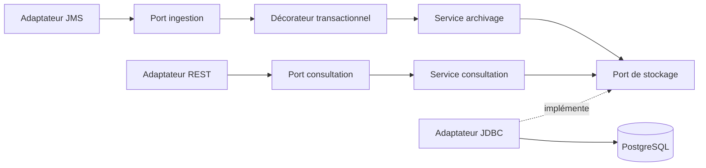

# Architecture et décisions

## Périmètre

Le système reçoit, archive et expose les messages à la consultation. Le contexte évoque un routage vers d’autres destinations, mais les fonctions demandées ne spécifient ni règles ni protocoles de routage. Aucun transfert métier vers d’autres applications n’est implémenté. Le transfert en quarantaine est une gestion technique des formats refusés. L’authentification et les autorisations applicatives sont hors périmètre.

## Transaction de réception

1. Le `DefaultMessageListenerContainer` ouvre une transaction JMS locale et reçoit le message.
2. `JmsMessageDecoder` extrait l’identifiant JMS/MQ, la corrélation, la source et le contenu.
3. `MessageMqAdapter` appelle le port `IngestMessageUseCase`. Son implémentation est le décorateur Spring `TransactionalMessageIngestion`, sous `@Transactional`, qui délègue à `ArchiveMessageService` puis au port `MessageArchivePort`. L'adaptateur JDBC applique `INSERT ... ON CONFLICT DO NOTHING` ; la contrainte unique arbitre les doublons, y compris entre instances concurrentes.
4. Le commit PostgreSQL est terminé avant le retour du service vers le listener.
5. Si le contenu est refusé, le listener envoie le message d’origine en quarantaine avec **la même session JMS**, en livraison persistante et sans expiration.
6. Au retour du listener, le conteneur commit la transaction MQ. En cas d’exception, il rollback la réception et l’éventuel envoi en quarantaine.

| Point de panne | Conséquence et reprise |
|---|---|
| Avant commit SQL | Pas de nouvelle ligne durable ; rollback MQ puis nouvelle livraison |
| Après commit SQL, avant commit MQ | Ligne déjà présente ; nouvelle livraison puis conflit unique sans insertion |
| Envoi vers la quarantaine refusé | La référence SQL peut être visible ; le message reste dans la file d’entrée et l’envoi est retenté |
| Après commit MQ | Le message est archivé ; un rejet est aussi présent dans la file de quarantaine |
| SQL indisponible | Pas d’acquittement ; nouvelles tentatives espacées d’une seconde par consommateur |
| MQ indisponible | Reconnexion du client et du conteneur ; archives existantes consultables tant que SQL fonctionne |

Les champs `receivedAt` et `redelivered` décrivent le **premier archivage réussi**, sans modification à chaque tentative. Deux messages avec des contenus identiques et des identifiants MQ différents restent deux messages distincts. Le producteur doit fournir des messages persistants, avec une durée de vie compatible avec les délais de reprise ; l’application ne peut empêcher l’expiration décidée par le producteur ou la perte d’un message non persistant lors d’une panne MQ.

L’archivage en base et la mise en quarantaine sont deux commits de ressources distinctes : une ligne `QUARANTINED` peut être visible avant que l’envoi MQ aboutisse. Le texte de l’IHM tient compte de cette validation différée. Le nouveau message de quarantaine peut recevoir un nouvel identifiant MQ ; la référence SQL conserve l’identifiant reçu sur la file d’entrée.

La déduplication repose sur la conservation de la clé `(source_queue, mq_message_id)`. Une politique de purge doit conserver ces clés au moins pendant la fenêtre maximale de rejeu (ou les déplacer dans un registre de déduplication). Elle n’est pas fondée sur un hash de contenu, qui supprimerait des paiements légitimement identiques.

## MQ et messages problématiques

Les files de développement sont persistantes et limitées à 4 Mio par message. Le seuil d’acceptation applicatif est de 1 Mio. Un `TextMessage` doit être matérialisé avant sa taille UTF-8 ; `MAXMSGL` protège donc également la mémoire. Pour un `BytesMessage`, la longueur est contrôlée avant allocation.

`BOTHRESH(0)` désactive le déplacement automatique du client JMS vers une backout queue. Ce point est essentiel : une panne SQL prolongée ne doit pas déplacer un message sans référence SQL. Les formats refusés sont gérés explicitement par le listener. Si la quarantaine est pleine ou inaccessible, la réception est annulée et une alerte d’exploitation est nécessaire. Un identifiant MQ absent ou une erreur de lecture de métadonnées provoque aussi une reprise ; cela requiert une intervention si le message est structurellement illisible.

Seuls les en-têtes nécessaires sont stockés : identifiant, corrélation, source, file, dates, type, taille et indicateur de relivraison. `sourceApplication` manque : valeur `UNKNOWN` ; dépasse 128 caractères : tronquée à 128. Les autres propriétés JMS ne sont pas archivées. Le texte est conservé comme contenu sémantique UTF-8, pas comme une capture brute des octets du protocole MQ.

## Performance

JDBC est utilisé directement pour maîtriser les requêtes et éviter le chargement de corps binaires dans les listes. Les insertions sont unitaires pour garder simple la reprise. Chaque consommateur attend le commit SQL ; le pool de connexions et les consommateurs bornent la concurrence. Le débit peut être augmenté en ajoutant des consommateurs/instances jusqu’à la capacité de PostgreSQL et MQ, à mesurer.

La pagination utilise une clé `id < beforeId`, avec tri décroissant et limite plafonnée. Les filtres sont paramétrés, sans concaténation de saisie utilisateur. Les index portent sur la date, le statut, la source et la corrélation. Les index ne couvrent pas toutes les combinaisons possibles ; utiliser `EXPLAIN (ANALYZE, BUFFERS)` avec la distribution réelle avant d’en ajouter.

L’identité SQL correspond à l’ordre d’allocation, pas à un horodatage global ni à l’ordre des commits. La consultation est vivante et ne constitue pas un export transactionnel figé : une transaction tardive ou de nouveaux messages nécessitent une actualisation. Le contrat évite de promettre un instantané global.

Les lectures restent limitées à une page de métadonnées ou au contenu du message sélectionné. Le dimensionnement, la rétention et le partitionnement seront fixés avec les objectifs de volumétrie du client.

## Conception hexagonale du backend

Le module fonctionnel `messages` possède trois couches :

- `domain` : records immuables, types énumérés et invariants. Les tableaux d'octets sont copiés pour ne pas exposer un état mutable.
- `application` : ports entrants `IngestMessageUseCase` et `ConsultMessagesUseCase`, port sortant `MessageArchivePort` et services Java. Aucun import Spring, JDBC, JMS ou IBM.
- `infrastructure` : adaptateurs MQ, REST et PostgreSQL, mapping des DTO, transaction et configuration Spring.

`MessageBeanConfiguration` assemble les services et le décorateur. Le bean d'ingestion injecté dans l'adaptateur MQ est le décorateur proxifié par Spring : la transaction SQL est donc terminée avant le retour au listener. Le service métier ne dépend pas de la transaction Spring et n'est pas enregistré une seconde fois comme bean d'ingestion.

Les DTO HTTP restent dans l'adaptateur REST. `MessageResponseMapper` transforme les identifiants 64 bits en chaînes et le contenu en texte UTF-8 ou Base64. Le domaine et le stockage ne connaissent pas ces choix de transport. Les transformations de listes utilisent les streams Java ; le décodage JMS emploie le pattern matching de Java 21.

| Pattern | Usage et raison |
|---|---|
| Ports et adaptateurs | Les cas d'utilisation restent indépendants des protocoles et de PostgreSQL |
| Repository via un port | Le contrat de stockage est testable sans imposer un framework de persistance |
| Decorator | La transaction encadre l'ingestion sans annotation Spring dans le cœur |
| Mapper | Les réponses REST sont séparées des modèles et des octets stockés |
| Facade | Une façade Angular centralise recherche, pagination et sélection pour la page |
| Observer via RxJS | Les changements de recherche pilotent les requêtes annulables et leur état |

JDBC reste adapté aux requêtes SQL précises du projet ; introduire JPA n'améliorerait pas le besoin actuel. Il n'y a ni hiérarchie artificielle de services, ni factories pour chaque DTO, ni répertoires vides. Les quatre règles ArchUnit vérifient l'indépendance du cœur, l'absence d'accès direct des adaptateurs entrants au stockage concret et l'absence de cycles entre les couches.

## Organisation Angular et flux réactifs

`core` regroupe les services transversaux uniques (URL API, intercepteur d'erreur, en-tête). `shared` contient uniquement le loader et le pipe de taille réutilisables. La fonctionnalité `features/messages` regroupe sa route, sa page, ses composants de présentation, son client HTTP, ses modèles et son état. Les alias TypeScript `@core`, `@shared` et `@features` raccourcissent les imports transversaux ; les imports internes à la fonctionnalité restent relatifs.

La route `/messages` charge la page à la demande. Les composants standalone utilisent `OnPush`, les entrées/sorties `input` et `output`, et les templates `@if`/`@for` avec suivi par identifiant. Le bootstrap active la détection des changements zoneless. Les dates utilisent la locale française.

`MessagesStore` est fourni au niveau de la page. Ses flux RxJS reçoivent les recherches et sélections ; `switchMap` annule la requête précédente, notamment lorsqu'on ferme un détail en cours de chargement. Chaque requête émet un état de chargement puis un résultat ou une erreur. `catchError` reste dans le flux interne pour qu'une erreur n'empêche pas les recherches suivantes. `toSignal` expose cet état aux templates et gère le désabonnement avec le cycle de vie de la page. Les composants de présentation n'appellent pas `HttpClient` et ne font pas de `subscribe` manuel.

Le formulaire réactif typé valide la longueur des filtres et l'ordre des dates avant émission. Le bouton Rechercher déclenche explicitement la recherche ; il n'y a pas de requête à chaque frappe. Le retour à une page précédente conserve les filtres appliqués. L'intercepteur fonctionnel transforme les erreurs API en messages lisibles sans exposer les détails SQL. La fenêtre native `dialog` gère le focus modal et la fermeture par Échap ; Angular échappe le contenu affiché. Les formulaires réactifs typés suffisent ici, sans dépendance à une API de formulaire expérimentale.

Prettier utilise explicitement le parseur Angular pour les templates et le pipeline vérifie le formatage. Les tests couvrent l'annulation, la reprise après erreur, la pagination, le nettoyage à la destruction, le formulaire, les erreurs HTTP et l'affichage échappé.

## Déploiement bancaire

L’environnement Compose sert au développement et aux tests, avec une instance de chaque service. Il ne constitue pas une configuration haute disponibilité. Pour la production : utiliser le MQ existant avec TLS, fournir `MQ_SSL_CIPHER_SUITE` et les paramètres de truststore JVM, externaliser les secrets, déployer PostgreSQL avec sauvegardes/restauration vérifiées, superviser la profondeur des files et les taux de rollback, et configurer les ressources des instances applicatives. Le TLS n’est pas activé dans le Compose local.

L’interface et l’API n’intègrent aucune authentification, selon la demande. Les payloads sont affichés comme du texte échappé par Angular et ne sont pas interprétés comme du HTML. Ils ne sont pas écrits dans les journaux applicatifs. Les métriques évitent les identifiants de message et autres tags à forte cardinalité.

## Sources techniques

- [Spring : transactions JMS locales et détection des doublons](https://docs.spring.io/spring-framework/reference/integration/jms/receiving.html)
- [Spring Boot : prérequis](https://docs.spring.io/spring-boot/system-requirements.html)
- [Angular : compatibilité Node et TypeScript](https://angular.dev/reference/versions)
- [Angular : organisation par fonctionnalité](https://angular.dev/style-guide)
- [Angular : interopérabilité RxJS et signals](https://angular.dev/ecosystem/rxjs-interop)
- [Angular : formulaires typés](https://angular.dev/guide/forms/typed-forms)
- [IBM MQ : configuration de l’image de développement](https://github.com/ibm-messaging/mq-container/blob/master/docs/developer-config.md)
